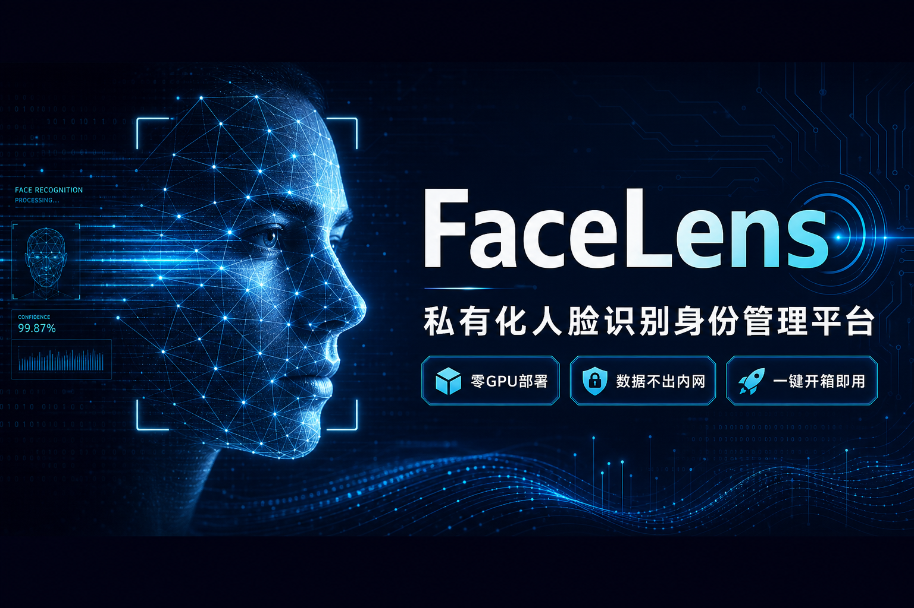
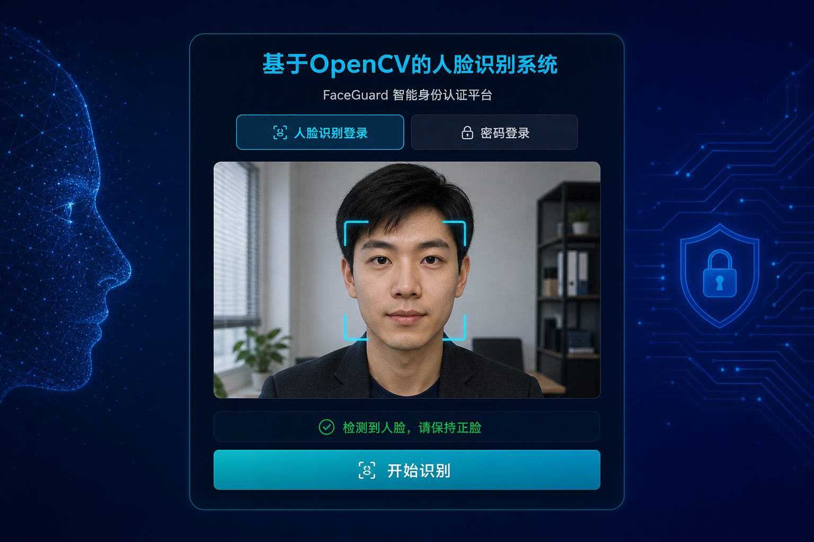
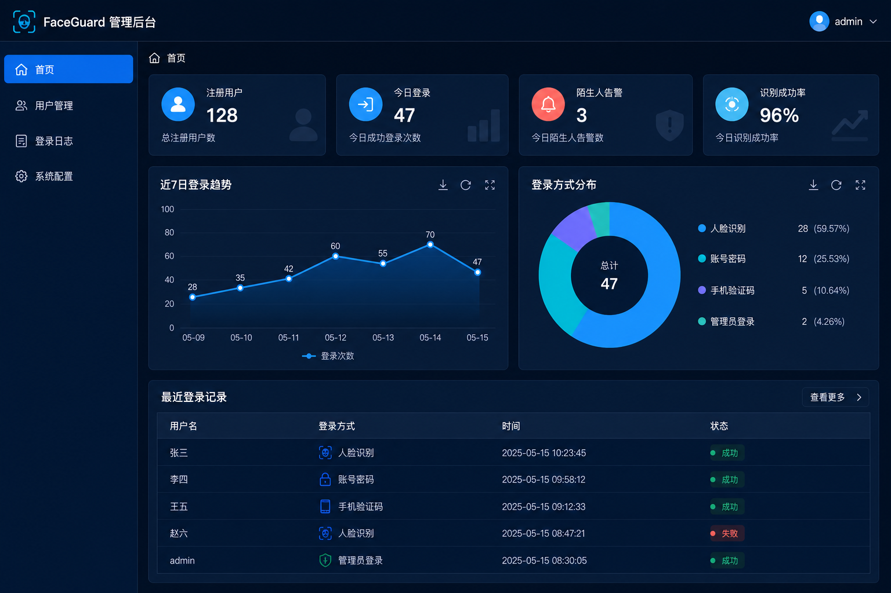
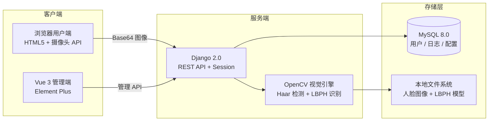

<div align="center">



<br>

# FaceLens · FaceGuard

### 看一眼，就通行 —— 零 GPU、私有化部署的人脸识别身份管理平台

**告别门禁卡丢失与密码遗忘。浏览器打开，摄像头对准，3 分钟完成人脸录入，即刻刷脸登录。**

<br>

[](https://github.com/Drgonmancer/FaceLens/stargazers)
[](#-许可证)
[](https://www.python.org/)
[](https://www.djangoproject.com/)
[](https://opencv.org/)
[](https://www.mysql.com/)

<br>

[**⬇️ 立即下载**](#-30-秒上手) · [**📖 查看文档**](#-文档导航) · [**⭐ Star 支持项目**](https://github.com/Drgonmancer/FaceLens/stargazers)

</div>

---

## 为什么选择 FaceLens？

> 市面上的人脸识别方案，要么**贵**（硬件 + 专业运维），要么**数据上云**（隐私顾虑）。  
> FaceLens 走第三条路：**私有化部署 + 轻量化运维 + 开箱即用**。

<table>
<tr>
<td width="33%" align="center">

### 🚀 即装即用

Windows 双击 `install.bat`  
自动装 Python、MySQL、依赖  
**5 分钟跑起来**

</td>
<td width="33%" align="center">

### 🔒 数据不出内网

人脸图像、识别模型  
全部存本地服务器  
**零上云风险**

</td>
<td width="33%" align="center">

### 💻 无需 GPU

Haar 检测 + LBPH 识别  
普通 CPU 即可流畅运行  
**零硬件额外投入**

</td>
</tr>
<tr>
<td width="33%" align="center">

### 🌐 纯浏览器体验

用户端无需装 App  
打开网页就能注册、采集、刷脸  
**B/S 架构零客户端**

</td>
<td width="33%" align="center">

### 🛡️ 安全可审计

登录日志、陌生人告警  
识别阈值可调（40～100）  
**管理员全程掌控**

</td>
<td width="33%" align="center">

### 📦 完全开源

MIT 协议，可商用  
适合毕设、二开、企业内部部署  
**拿来就能改**

</td>
</tr>
</table>

---

## ✨ 核心功能一览

| 模块 | 能力 | 亮点 |
|:---:|:---|:---|
| 🔐 **双模登录** | 人脸识别 / 账号密码 | 人脸未录入时自动降级密码登录，无缝过渡 |
| 📷 **智能采集** | 浏览器摄像头实时预览 | 质量检测 + 多角度引导，3～6 张即可训练 |
| 🧠 **自动训练** | LBPH 模型一键生成 | 新用户录入后自动重训，无需手动操作 |
| 👥 **用户管理** | 注册、审核、权限控制 | RBAC 角色分离，管理员 / 普通用户各司其职 |
| 📊 **安全审计** | 登录日志 + ECharts 可视化 | 谁在何时登录，一目了然 |
| ⚠️ **陌生人告警** | 未匹配人脸实时预警 | 陌生访客尝试登录，管理员即时知晓 |
| ⚙️ **灵活配置** | 识别阈值、系统参数 | 按场景调优，室内弱光也能适配 |

---

## 🎯 适用场景

```
🏢 中小企业门禁        🏫 校园考勤签到        🏘️ 小区访客管理
📋 实验室设备准入      🎓 毕业设计 / 课程项目   🔧 人脸识别二次开发底座
```

无论你是**想给公司上一套轻量门禁**，还是**需要一个能跑通全流程的 OpenCV 实战项目**，FaceLens 都能直接落地。

---

## 🖼️ 系统预览

> 💡 **提示**：以下为产品界面效果图。克隆仓库后运行 `start.bat`，浏览器将自动打开，即可亲身体验完整流程。

<table>
<tr>
<td align="center" width="50%">

**用户端 · 刷脸登录**



深色科技风 UI · 实时摄像头预览 · 人脸框检测

</td>
<td align="center" width="50%">

**管理端 · 数据驾驶舱**



Vue 3 + Element Plus · 用户管理 · 日志审计

</td>
</tr>
</table>

---

## ⚡ 30 秒上手

### 方式一：一键安装（Windows 推荐）

```text
右键 install.bat → 以管理员身份运行 → 等待自动完成 → 浏览器自动打开
```

脚本将自动完成：Python 环境 · MySQL 数据库 · 依赖安装 · 库表初始化 · 服务启动

### 方式二：快速启动（已有环境）

```bash
# 克隆仓库
git clone https://github.com/Drgonmancer/FaceLens.git
cd FaceLens

# 双击或命令行运行
start.bat        # Windows
./install.sh     # Linux / macOS
```

### 方式三：手动部署

```bash
cd server
copy config.ini.example config.ini   # 编辑 MySQL 密码
pip install -r requirements.txt
python manage.py runserver 0.0.0.0:8000
```

<br>

<div align="center">

| 入口 | 地址 | 默认账号 |
|:---:|:---|:---|
| 👤 **用户端** | http://localhost:8000/cl3286667/ | 注册后使用 |
| 🔧 **管理端** | http://localhost:8000/cl3286667/manage/ | `admin` / `admin` |

</div>

### 首次体验三步走

```
1️⃣ 注册账号 → 2️⃣ 个人中心采集 3～6 张人脸 → 3️⃣ 退出后用「人脸识别登录」
```

---

## 🏗️ 技术架构



| 层级 | 技术选型 | 说明 |
|:---:|:---|:---|
| 后端 | Python · Django 2.0 · PyMySQL | MTV 架构，Session 认证，中间件鉴权 |
| 视觉 | OpenCV 4.x（Haar + LBPH）· NumPy · Pillow | 经典算法组合，CPU 友好，识别准确 |
| 数据库 | MySQL 8.0 | 结构化数据持久化，支持 utf8mb4 |
| 用户端 | 原生 HTML5 / JS | 内置于 `server/templates/client`，零构建 |
| 管理端 | Vue 3 · Element Plus | 位于 `client/`，构建后部署至 `server/templates/manage/` |

---

## 📁 项目结构

```
FaceLens/
├── client/              # Vue 3 管理端（Element Plus）
├── server/              # Django 后端 + 用户端页面
│   ├── main/            # 业务逻辑（用户、人脸、日志）
│   ├── util/            # OpenCV 人脸识别核心
│   ├── templates/       # 用户端 & 管理端静态页面
│   └── sql/             # 数据库初始化脚本
├── docs/                # 完整技术文档
├── install.bat          # Windows 全自动安装（Python + MySQL + 依赖）
├── install.sh           # Linux / macOS 安装脚本
├── start.bat            # 一键启动（自动创建虚拟环境）
└── README.md
```

---

## 📊 与同类方案对比

| 维度 | 商业硬件方案 | SaaS 云服务 | **FaceLens** |
|:---:|:---:|:---:|:---:|
| 部署成本 | 💰💰💰 高 | 💰 订阅制 | ✅ **免费开源** |
| 数据隐私 | 本地 | ⚠️ 上云 | ✅ **完全本地** |
| GPU 要求 | 视方案而定 | 云端处理 | ✅ **纯 CPU** |
| 二次开发 | 封闭 | API 受限 | ✅ **MIT 全源码** |
| 上手难度 | 需专业团队 | 注册即用 | ✅ **一键脚本** |
| 适用规模 | 大型企业 | 中小团队 | ✅ **中小组织 / 学习** |

---

## 📚 文档导航

| 文档 | 内容 | 适合谁 |
|:---|:---|:---|
| [快速启动文档](./docs/快速启动文档.md) | 环境要求、安装步骤、常见问题 | 所有人 ⭐ |
| [人工配置文档](./docs/人工配置文档.md) | MySQL 配置、阈值调优、排错指南 | 运维 / 部署 |
| [后端 API 接口文档](./docs/后端API接口文档.md) | RESTful 接口清单与参数说明 | 开发者 |
| [需求规格说明书](./docs/需求规格说明书.md) | 功能范围、用户故事、验收标准 | 产品 / 测试 |
| [技术实现方案](./docs/技术实现方案.md) | 算法原理、架构设计、关键实现 | 开发者 |
| [数据库设计](./docs/DATABASE_DESIGN.md) | 表结构、字段说明、ER 关系 | 开发者 / DBA |

---

## ❓ 常见问题

<details>
<summary><b>摄像头无法调用？</b></summary>

请使用 `http://localhost` 访问（非 IP 地址），并在浏览器弹窗中允许摄像头权限。HTTPS 或 localhost 是 WebRTC 的安全要求。

</details>

<details>
<summary><b>人脸识别准确率低？</b></summary>

1. 确保光线充足、正脸采集  
2. 重新采集 3～6 张不同角度的人脸  
3. 在管理后台调低 `face_threshold`（范围 40～100，越低越严格）

</details>

<details>
<summary><b>MySQL 连接失败？</b></summary>

检查 MySQL 服务是否启动，确认 `server/config.ini` 中的密码与端口正确。详见 [人工配置文档](./docs/人工配置文档.md)。

</details>

<details>
<summary><b>如何二次开发管理端？</b></summary>

```bash
cd client
npm install
npm run serve          # 开发模式
npm run build          # 构建产物输出到 server/templates/manage/
```

</details>

---

## 🤝 参与贡献

欢迎提交 Issue 和 Pull Request！无论是 Bug 修复、功能增强还是文档完善，都是对项目的巨大帮助。

1. Fork 本仓库
2. 创建特性分支：`git checkout -b feature/amazing-feature`
3. 提交更改：`git commit -m 'Add amazing feature'`
4. 推送分支：`git push origin feature/amazing-feature`
5. 发起 Pull Request

---

## 📄 许可证

本项目基于 **MIT License** 开源，可自由使用、修改和商用。

---

<div align="center">

**如果这个项目对你有帮助，请点亮一颗 ⭐ Star，让更多人发现它！**

<br>

[](https://github.com/Drgonmancer/FaceLens/stargazers)

Made with ❤️ by [Drgonmancer](https://github.com/Drgonmancer)

</div>
